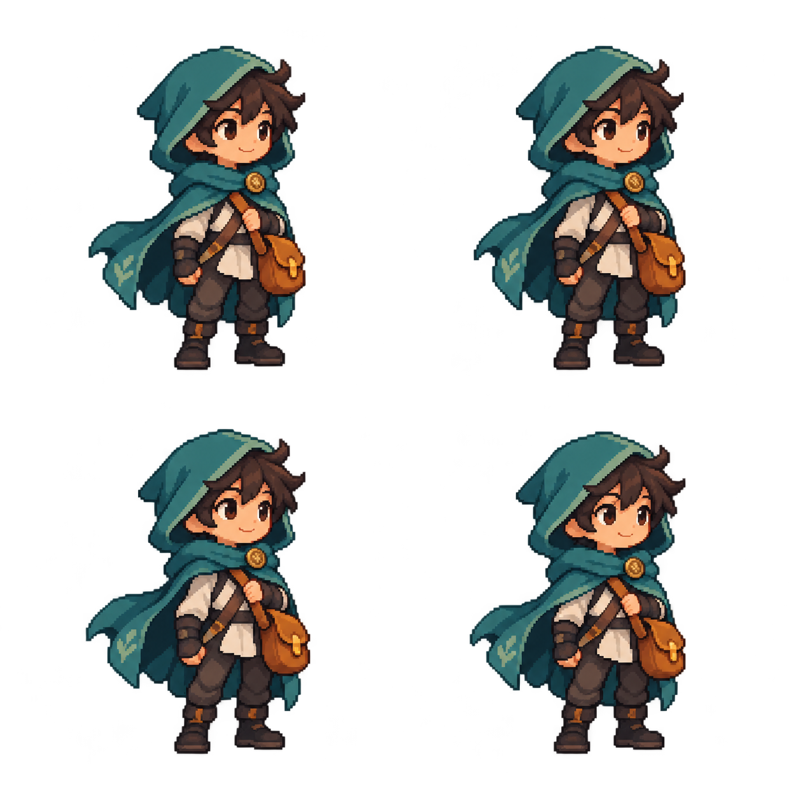
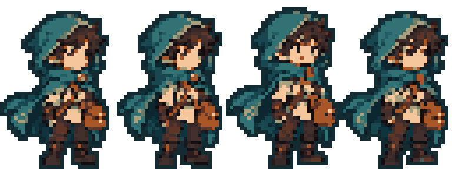
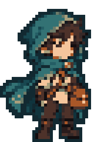

# Generated courier cleanup demo

`before.png` is the original 2x2 pose image generated with Codex's built-in image
generation tool on 13 October 2026. It contains an original forest courier,
without third-party reference images or brand material. The prompt requested
four consistent, transparent, full-body teal-cloak/amber-satchel idle poses with
limited colours and generous padding. The model output is illustrative demo art,
not an artist-approved production asset.



The deterministic script splits the 2x2 sheet into `pose-1.png` through
`pose-4.png`, cleans the base to 32x32, then assembles four 32x48 idle frames with
16 shared colours plus a dark 1px outline. Frame durations are 180/140/180/140 ms.




`base/` and `idle/` preserve editable `master.aseprite` files, cleaned PNGs,
reopened-master renders, sheets, JSON and pixel-verification reports. No generated
frame is discarded. Bounding-box alignment places the feet consistently, but the
generated third pose still changes the face and silhouette slightly. Review and
refine those details in Aseprite before using the character in a game.

From the repository root, with your own Aseprite executable configured:

```sh
uv run python scripts/generated_sprite_demo.py --output-prefix proof
```

This writes new `proof-base/` and `proof-idle/` bundles and `proof-*` previews in
this folder. Use a different prefix on subsequent runs: existing bundles are
refused. No network calls, publishing or release actions occur. Input pose splits
are reproducible from the committed original image.
